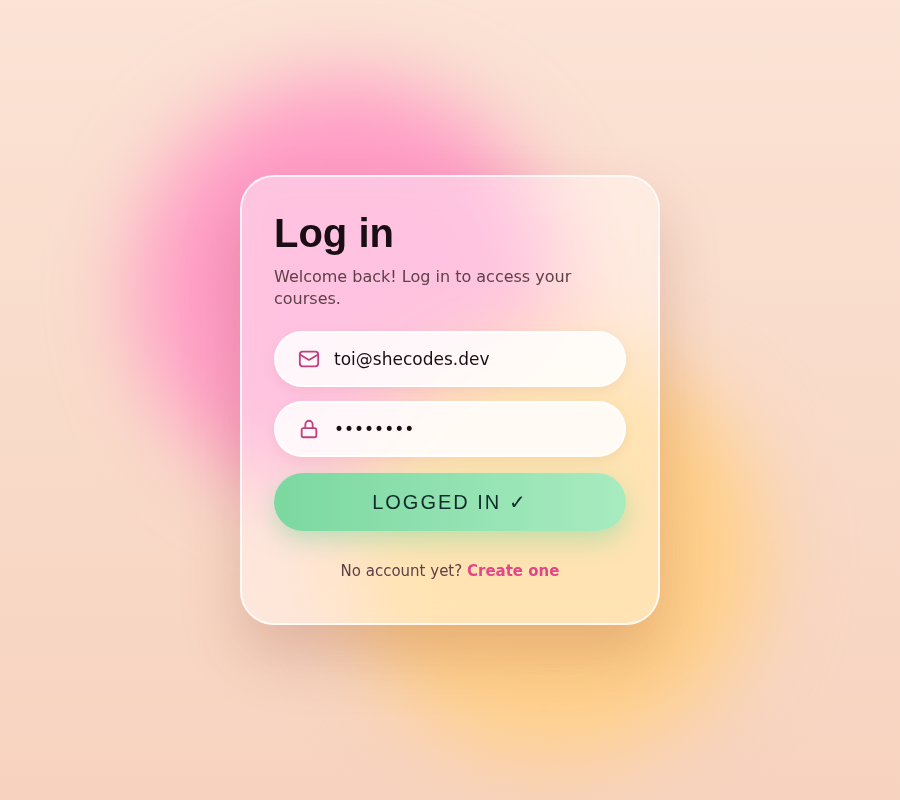

# Animated Glass Login Form 💗

A frosted-glass login form with a bouncy **pop** animation — pure HTML & CSS, no libraries.
Made by [@she.codesdaily](https://instagram.com/she.codesdaily).

**▶ Live demo:** https://fatimawork.github.io/animated-login-form/



## Features
- Glassmorphism card (`backdrop-filter: blur()`)
- "Pop" entrance with a bounce: `cubic-bezier(.3, 1.6, .5, 1)`
- Rounded inputs with icons and a pink focus ring
- Success state on submit ("LOGGED IN ✓")
- Respects `prefers-reduced-motion`
- Responsive, one single file

## How to use
1. Download `index.html` (or click **Code → Download ZIP**)
2. Open it in your browser
3. Copy the CSS/HTML into your own project

> This is a front-end demo: there is no real login. Connect the form to your own backend in the `submit` handler.

## The key part
```css
.login {
  backdrop-filter: blur(16px) saturate(1.2);
  animation: pop 0.7s cubic-bezier(0.3, 1.6, 0.5, 1) both;
}

@keyframes pop {
  from { opacity: 0; transform: translate(-60px, 80px) scale(0) rotate(-10deg); }
  to   { opacity: 1; transform: translate(0, 0) scale(1) rotate(0); }
}
```

## License
MIT — free to use in your projects. A tag on Instagram is always appreciated ✨
